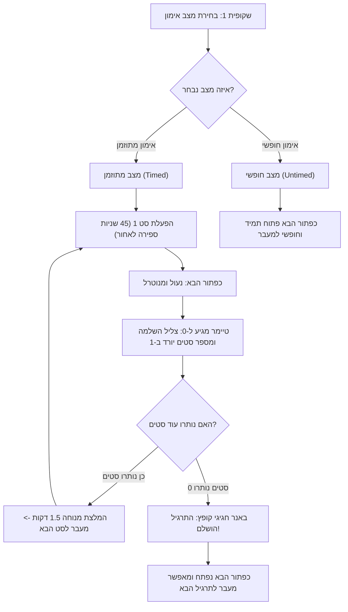

# R&L Fitness - 10-Slide Interactive Workout Web Application 🏋️‍♂️

> **אפליקציית ווב אינטראקטיבית לאימון כוח פונקציונלי ב-10 שלבים, מותאמת באופן מלא לעברית (RTL), עם הדמיות תלת-ממדיות (3D) אינטראקטיביות ב-Three.js, מעקב סטים וטיימר מובנה.**

---

## 🌟 סקירה כללית (Overview)

**R&L Fitness** היא אפליקציית כושר מודרנית ויוקרתית בת 10 שקופיות, המיועדת להעניק חוויית אימון שלמה, מדויקת ומעוררת השראה באורך של **שעה אחת סה"כ**. 

האימון מורכב מ-**8 תרגילי יסוד** להפעלת כל שרירי הגוף, כאשר כל תרגיל כולל:
- הוראות ביצוע טכניות מפורטות ומדויקות בעברית.
- תגיות שרירי מטרה אנטומיים.
- צילום סטוק איכותי ומעורר מוטיבציה.
- **הדמיה תלת-ממדית (3D Simulation)** אינטראקטיבית מבוססת Three.js המציגה **מנח יציבה סטטי מדויק (Static Posture)** של דמות אנושית בטכניקה מושלמת, עם דגשי ביצוע אנטומיים, בורר זוויות צפייה ושליטה מלאה ב-360 מעלות.
- מערכת מעקב סטים (3 סטים לתרגיל) וטיימר 45 שניות מובנה עם התראות קוליות (Web Audio API).

---

## 🎨 מערכת העיצוב והשפה החזותית (Design System & Theme)

האפליקציה עוצבה בהשראת לוחות מחוונים (Dashboards) יוקרתיים מעולמות הוולנס, השקט הנפשי והספורט המקצועי:

| צבע / רכיב | קוד HEX / ערך | תיאור ושימוש |
| :--- | :--- | :--- |
| **Primary / Accent** | `#8FA28A` | ירוק מרווה אלגנטי (Sage Green) לכפתורים עיקריים, מחווני התקדמות ודגשים |
| **Secondary** | `#C7D3C0` | ירוק מרווה בהיר (Light Sage) לרקעים משניים וחלקי גוף הדמיה |
| **Background / Neutral** | `#F7F4ED` | קרם חמים (Warm Cream) לרקע הכללי לתחושת רוגע ואיכות |
| **Highlight / Gold** | `#C8A96B` | זהב מאופק (Muted Gold) להשלמת סטים, גביעי ניצחון ומפרקי הדמיה |
| **Text Primary** | `#273328` | ירוק-אפור עמוק לקריאות מרבית וניגודיות גבוהה |
| **Typography** | `Rubik`, `Heebo` | גופנים מודרניים נקיים וקריאים המותאמים אופטימלית לעברית (Google Fonts) |
| **BiDi & RTL** | `dir="rtl"` | תמיכה קפדנית בכיווניות ימין-שמאל בכל רכיבי הממשק, כפתורים, ניווט וטיפוגרפיה |

---

## 📋 מבנה 10 השקופיות (10-Slide Architecture)

### שקופית 1: מסך פתיחה והגדרות (Welcome & Setup)
- **כותרת**: *"ברוכים הבאים לאימון כוח פונקציונאלי"*.
- **סקירה**: הסבר מקיף שהאימון אורך **שעה אחת סה"כ** ומורכב מ-**8 תרגילי ליבה**.
- **פירוט רכיבי התרגיל**: הצגת ההוראות, שרירי המטרה, כפתור הדמיית 3D ואפשרויות הטיימר.
- **בחירת מצב אימון (Workout Mode Selection)**:
  1. **אימון מתוזמן (Timed Workout)**: כולל טיימר של 45 שניות לכל סט ו-3 סטים לכל תרגיל (1.5 דקות מנוחה מומלצות בין סטים). במצב זה כפתור "הבא" נעול עד לסיום מלא של ספירת הסטים וקפיצת באנר ההשלמה.
  2. **אימון חופשי (Untimed Workout)**: ללא כפיית זמנים – כפתור "הבא" נגיש ופתוח בחופשיות מלאה בכל שלב.
- **כפתור חזור גלובלי (Global Back Button)**: פעיל וזמין באופן רציף לאורך כל מסכי האפליקציה.

---

### שקופיות 2 עד 9: שמונת תרגילי היסוד (The 8 Core Exercises)

כל שקופית תרגיל כוללת:
- שם התרגיל בעברית ובאנגלית.
- תגיות שרירי מטרה אנטומיים.
- הוראות ביצוע מפורטות ומדויקות.
- כפתור הדמיית 3D אינטראקטיבי המפעיל חלון מודאלי.
- תמונת סטוק מקצועית תואמת.
- כרטיס מעקב סטים (3 סטים) וטיימר 45 שניות עם חוגת SVG עגולה.
- באנר השלמה חגיגי הקופץ כאשר הסטים מגיעים ל-0 (במצב מתוזמן) ופותח את המעבר לתרגיל הבא.

| שקופית | תרגיל | שרירי מטרה | הנחיות ביצוע |
| :---: | :--- | :--- | :--- |
| **2** | **סקוואטים (Squats)** | שריר הישבן וארבע ראשי (*Glutes & Quadriceps*) | עמדו בפיסוק ברוחב הכתפיים, כאשר כפות הרגליים פונות מעט החוצה. שמרו על שכמות אסופות וגב ישר וזקוף. רדו עם האגן לכיוון הרצפה תוך שמירה על גב ישר, עד לזווית של 90 מעלות בברכיים, ולאחר מכן דחפו חזרה מעלה. |
| **3** | **שכיבות סמיכה (Push-ups)** | חזה וכתף קדמית (*Chest & Anterior Deltoid*) | התמקמו על שש, רגליים ישרות לאחור וכפות רגליים צמודות. כפות הידיים על הרצפה במפתח מעט רחב מרוחב הכתפיים. כופפו את המרפקים כדי להוריד את בית החזה לאט לכיוון הרצפה, ודחפו חזרה למעלה בעוצמה ובמהירות. ודאו שאין שקיעה של האגן; התנועה מגיעה ממפרק הכתף. |
| **4** | **פשיטת מרפקים על ספה או שולחן (Bench Dips)** | יד אחורית (*Triceps*) | שבו על קצה הספה או השולחן, הניחו את כפות הידיים לצד האגן כשהאצבעות פונות קדימה. הזיזו את האגן מעט קדימה מחוץ לקצה, כשהרגליים ישרות קדימה על הרצפה. כופפו באיטיות את המרפקים כדי להוריד את הגוף, תוך שמירה על מרפקים קרובים לגוף, ואז דחפו חזרה בעוצמה באמצעות הזרועות. |
| **5** | **עליות מדרגה על כיסא (Step-ups on Chair)** | ארבע ראשי ואמסטרינג (*Quadriceps & Hamstrings*) | הציבו כיסא יציב לפניכם, הניחו רגל אחת במרכז מושב הכיסא. דחפו בעוצמה דרך כף הרגל שעל הכיסא עד ליישור מלא של הברך, כאשר הרגל השנייה מרחפת באוויר ללא תמיכה. הימנעו מרכינה מוגזמת קדימה כדי להגן על הברך. רדו לאט ובשליטה. החליפו רגליים כל 20 שניות. |
| **6** | **לאנצ'ים (Lunges)** | ארבע ראשי, המסטרינגס וישבן (*Quads, Hamstrings & Glutes*) | הציבו רגל אחת לאחור נשענת על כריות האצבעות, ברוחב פיסוק מתון מהרגל הקדמית. בית חזה מורם, גב ישר ויציב עם נטייה קלה קדימה. רדו עמוק ולאט ככל שניתן כאשר הברך האחורית שואפת לרצפה, ודחפו חזרה דרך כף הרגל הקדמית. |
| **7** | **סופרמן (Superman)** | גב (*Back / Erector Spinae*) | שכבו על הבטן עם ידיים ישרות קדימה ורגליים ישרות לאחור. הרימו בו-זמנית את הידיים, החזה וכפות הרגליים מעט מעל הרצפה תוך כיווץ שרירי הגב והישבן. שהו באוויר למשך 2 שניות ורדו באיטיות חזרה. |
| **8** | **כפיפות בטן (Crunches)** | שרירי בטן (*Rectus Abdominis*) | שכבו על הגב עם ברכיים כפופות וכפות רגליים מונחות על הרצפה. הידיים תומכות בעורף, המבט ממוקד קדימה לתקרה. הרימו את בית החזה מהרצפה באמצעות כיווץ שרירי הבטן, תוך שמירה על המבט קדימה ללא משיכת הצוואר. החזיקו בכיווץ למשך שנייה אחת ורדו חזרה. עלו רק עד חצי הדרך, לא עד הברכיים. |
| **9** | **פלאנק (Plank)** | שרירי בטן וליבה (*Core & Abdominals*) | רדו למנח פלאנק על האמות, כאשר המרפקים ממוקמים ישירות מתחת לכתפיים, והרגליים ישרות וצמודות. שמרו על אגן מוגבה בגובה החזה והחזיקו במנח סטטי בעזרת שרירי הליבה לאורך כל משך התרגיל. |

---

### שקופית 10: מסך סיום חגיגי (Completion Screen)
- **הודעת סיום**: *"סיימת בהצלחה את האימון, כל הכבוד!"*
- **אנימציית קונפטי**: מנוע חלקיקי קונפטי חי (HTML5 Canvas) בצבעי המערכת.
- **פסקול ניצחון**: מנגינת Fanfare חגיגית מבוססת Web Audio API.
- **כרטיסי מדדים וסיכום אימון**:
  - מספר תרגילים שהושלמו (8 / 8)
  - סך הסטים שבוצעו (24 סטים)
  - משך זמן אימון בפועל
  - קלוריות משוערות שנשרפו (~380-450 קק"ל)
- **המלצות התאוששות**: הנחיות לשתיית מים, מתיחות וארוחה שלאחר אימון.
- **כפתור "התחל אימון מחדש"**: איפוס מלא וחזרה לתחילת התהליך.
- **כפתור "הדפס / שמור סיכום"**: ייצוא והדפסה ישירה של נתוני האימון.

---

## 🕹️ הדמיות תלת-ממדיות ב-Three.js (3D Static Posture Simulations)

עבור כל אחד מ-8 התרגילים פותחה הדמיית מנח סטטי נקי ב-Three.js:
- **דמות אנושית אתלטית ומזוהה (Humanoid Character Model)**: דמות בעלת תווי פנים (עיניים, אף, גבות, אוזניים), שיער ספורטיבי מעוצב, גוון עור טבעי, ביגוד אימונים מודרני בגווני Sage Green ו-Dark Slate, נעלי ריצה ומפרקים אנטומיים חלקים (ללא חלקי רובוט או טבעות מתכת).
- **מנח יציבה סטטי מדויק (Static Form - No Repetition)**: מודל סטטי ויציב המדגים במדויק את תנוחת השיא והטכניקה המומלצת לכל תרגיל, ללא תנועות חוזרות או ניעות מטעות.
- **כרטיס דגשי יציבה וטכניקה (Form Cues Checklist)**: בכל תרגיל מוצגים 4 דגשים טכניים עיקריים בעברית לבחינת יישור עמוד השדרה, זוויות הברכיים והמרפקים ומנח כפות הרגליים.
- **אביזרי סביבה תלת-ממדיים (3D Props)**:
  - ספה/ספסל עבור פשיטת מרפקים (Bench Dips).
  - כיסא עץ ומתכת יציב עבור עליות מדרגה (Step-ups).
  - מזרן אימונים מקצועי עבור שכיבות סמיכה, סופרמן, כפיפות בטן ופלאנק.
- **מצלמת 360 מעלות אינטראקטיבית (OrbitControls)**: גרירת עכבר/מגע לסיבוב מכל זווית, גלגלת לזום.
- **בורר זוויות צפייה מהיר (Camera Presets)**:
  - **איפוס זווית (Default)**: זווית מומלצת מותאמת אישית לכל תרגיל.
  - **מבט צד (Side View - 90°)**: אידיאלי לבחינת זווית ברכיים ב-90° בסקוואט, שכיבות סמיכה ולאנצ'ים.
  - **מבט קדמי (Front View)**: לבחינת מפתח כתפיים ויישור הגוף.
  - **מבט אלכסוני (Isometric 3D)**: להתרשמות מרחבית מלאה.

---

## ⏱️ חוקי הטיימר ומצבי האימון (Workout Modes & Logic)



---

## 📂 מבנה הפרויקט (Project Directory Structure)

```
LiyaRoni-ex1/
├── app.py                     # שרת פייתון (Flask) המשרת את האפליקציה ומספק REST API
├── run.bat                    # קובץ הפעלה מהיר בלחיצה אחת למערכות Windows
├── requirements.txt           # תלויות הפרויקט (Flask, Jinja2, Werkzeug)
├── README.md                  # תיעוד מקיף של המערכת (מדריך זה)
├── static/
│   ├── css/
│   │   └── style.css          # עיצוב מקיף: RTL מלא, צבעי המערכת, טיפוגרפיה, אנימציות ורספונסיביות
│   └── js/
│       ├── three.min.js       # ספריית Three.js (גרסה מקומית לתמיכה ללא אינטרנט)
│       ├── OrbitControls.js   # בקרת סיבוב וזום תלת-ממדי
│       ├── mannequin.js       # בונה דמות אדם אתלטית ואביזרי אימון (מזרן, ספה, כיסא)
│       ├── animations.js      # 8 מנחי יציבה סטטיים ודגשי טכניקה אנטומיים
│       ├── simulator.js       # מנהל המודאל התלת-ממדי, זוויות צפייה ובקרת 360 מעלות
│       ├── audio.js           # מחולל צלילים דיגיטלי (Web Audio API) ללא קבצים חיצוניים
│       ├── confetti.js        # מנוע חלקיקי קונפטי לסיום האימון (Slide 10)
│       └── app.js             # מנוע האפליקציה: ניווט 10 שקופיות, לוגיקת טיימר וניהול מצבים
└── templates/
    └── index.html             # תבנית ה-HTML5 הראשית של כל 10 השקופיות
```

---

## 🚀 הוראות הרצה (How to Run the Project)

### דרישות קדם (Prerequisites)
- **Python 3.9 ומעלה** מותקן במחשב.
- דפדפן אינטרנט מודרני (Chrome, Edge, Firefox, Safari).

### הפעלה מהירה (Windows)
1. לחצו לחיצה כפולה על הקובץ **`run.bat`**.
2. הסקריפט יזהה אוטומטית את התקנת ה-Python ויפעיל את השרת המקומי.
3. פתחו את הדפדפן בכתובת:
   ```
   http://127.0.0.1:5000
   ```

### הפעלה ידנית באמצעות שורת הפקודה (Terminal / Command Line)
1. פתחו טרמינל בתיקיית הפרויקט:
   ```bash
   cd C:\VibeCoding\LiyaRoni-ex1
   ```
2. התקינו את התלויות הנדרשות:
   ```bash
   pip install -r requirements.txt
   ```
3. הפעילו את השרת:
   ```bash
   python app.py
   # או באמצעות py launcher:
   py app.py
   ```
4. גלשו בדפדפן אל:
   ```
   http://127.0.0.1:5000
   ```

---

## 🔌 נקודות קצה של השרת (REST API Endpoints)

השרת מספק בנוסף גם ממשק API מובנה:

- **`GET /api/exercises`**: מחזיר את קטלוג 8 התרגילים בפורמט JSON, כולל שמות בעברית ובאנגלית, שרירי מטרה, הנחיות ביצוע מדויקות ומטא-דאטה.
- **`POST /api/workout-summary`**: מקבל נתוני סיכום אימון (משך זמן, סטים, קלוריות, מצב אימון) ושומר אותם בזיכרון השרת.
- **`GET /api/stats`**: מחזיר סטטיסטיקה מצרפית על אימונים קודמים שהושלמו.

---

## 💡 שאלות נפוצות וטיפים (FAQ)

- **האם האפליקציה עובדת ללא חיבור לאינטרנט (Offline)?**
  כן! קובצי Three.js ו-OrbitControls מאוחסנים ישירות בתיקיית `static/js/`, ומערכת הצלילים נבנתה באמצעות סינתיסייזר פנימי של ה-Web Audio API (ללא תלות בקובצי MP3 חיצוניים).
- **כיצד מופעלת הדמיית ה-3D?**
  בכל שקופית של תרגיל קיים כפתור *"ראה דוגמה תלת מימדית"*. לחיצה עליו פותחת חלון תלת-ממדי מלא שבו ניתן לסובב את הגוף, לבחון את זוויות המפרקים, להאט את הקצב ולהבין את התנועה לעומק.
- **כיצד ניתן לחזור אחורה במהלך האימון?**
  כפתור "חזור לשלב הקודם" פעיל תמיד בכל השקופיות, ומאפשר לנווט בחופשיות אחורה ולרענן הוראות של תרגילים קודמים.

---

**אימון פורה ומוצלח! צוות R&L Fitness.**
