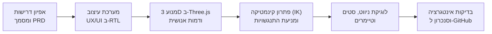
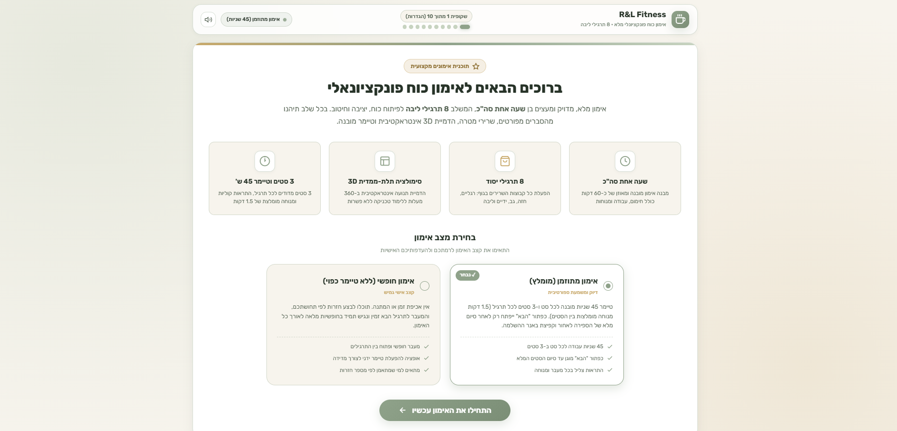
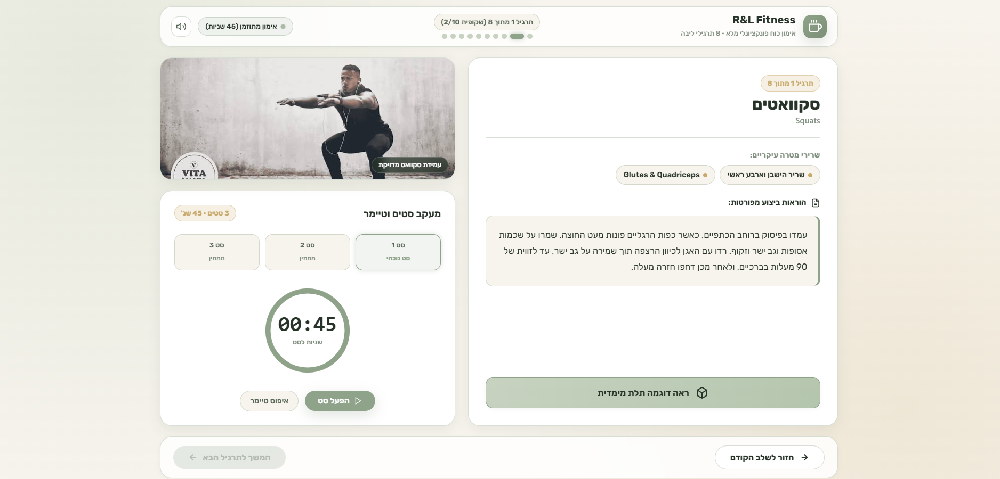
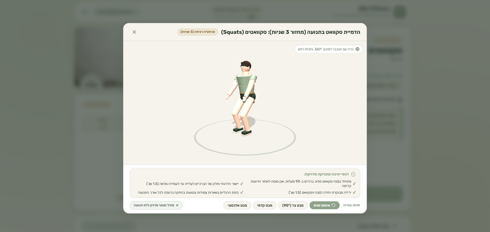
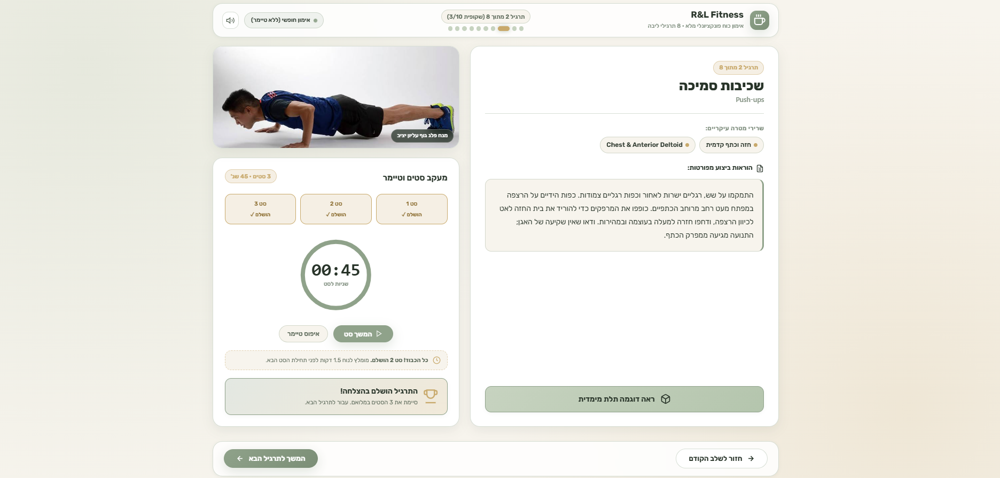
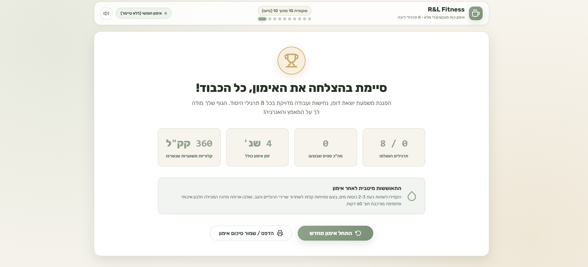

# R&L Fitness - 12-Slide Interactive Workout Platform 🏋️‍♂️

> **פלטפורמת אימון כוח אינטראקטיבית מודרנית בת 12 שקופיות, מותאמת באופן מלא לעברית (Full RTL/BiDi), הכוללת הדמיות תלת-ממדיות (Three.js 3D Simulations) עם דמות אנושית אתלטית ואנימציות תנועה מדויקות, מצבי אימון מתוזמן וחופשי, מעקב סטים וטיימר מובנה.**

---

### 📄 מסמך אפיון מוצר רשמי (PRD)
מסמך הדרישות המלא של הפרויקט זמין לעיון ישיר בתיקיית המסמכים:
👉 [**R&L Fitness - Product Requirements Document (PRD) - RTL (PDF)**](docs/R&L%20Fitness%20-%20Product%20Requirements%20Document%20(PRD)%20-%20RTL.pdf)

---

## 📑 תוכן העניינים (Table of Contents)
1. [Project Overview & Purpose (סקירה ומטרת הפרויקט לפי ה-PRD)](#1-project-overview--purpose-סקירה-ומטרת-הפרויקט-לפי-ה-prd)
2. [Target Audience & Business Goals (קהל יעד ומטרות עסקיות)](#2-target-audience--business-goals-קהל-יעד-ומטרות-עסקיות)
3. [Design System & Palette (מערכת עיצוב, פלטת צבעים ומבנה)](#3-design-system--palette-מערכת-עיצוב-פלטת-צבעים-ומבנה)
4. [Development Methodology & Workflow (מתודולוגיית פיתוח ותהליך עבודה)](#4-development-methodology--workflow-מתודולוגיית-פיתוח-ותהליך-עבודה)
5. [User Flow & Project Breakdown (ארכיטקטורת מסכים, פירוט תרגילים ומשאבים)](#5-user-flow--project-breakdown-ארכיטקטורת-מסכים-פירוט-תרגילים-ומשאבים)
6. [Visual Showcase (גלריית המחשה ויזואלית ומסכי המערכת)](#6-visual-showcase-גלריית-המחשה-ויזואלית-ומסכי-המערכת)
7. [How to Run (הוראות הרצה מקומית)](#7-how-to-run-הוראות-הרצה-מקומית)
8. [Technical Stack & Repository (ארכיטקטורה טכנולוגית וגיטהאב)](#8-technical-stack--repository-ארכיטקטורה-טכנולוגית-וגיטהאב)
9. [REST API Endpoints (ממשק נקודות קצה)](#9-rest-api-endpoints-ממשק-נקודות-קצה)
10. [Project History & Technical Decisions (היסטוריית פיתוח והחלטות טכניות)](#8-project-history--technical-decisions-היסטוריית-פיתוח-והחלטות-טכניות)

---

## 1. Project Overview & Purpose (סקירה ומטרת הפרויקט לפי ה-PRD)

**R&L Fitness** היא מערכת אימון פונקציונלי אינטראקטיבית מבוססת ווב (Web-based), המעוצבת כמצגת דיגיטלית חכמה בת **12 שקופיות**.

המערכת משלבת:
- הדרכות תרגילים טכניות מפורטות.
- תמונות מקצועיות מקומיות להמחשה ויזואלית מלאה.
- טיימרים מובנים לניהול סטים ומנוחות.
- הדמיות תלת-ממד (סטטיות ומונפשות) בטכנולוגיית **Three.js** המציגות את תנוחת הגוף האופטימלית לכל תרגיל במרחב 360 מעלות.
- התאמה מלאה לשפה העברית: פריסת ימין-לשמאל מלאה (**RTL**) וטיפול מבודד בכיווניות טקסט ומספרים (**BiDi**).
- גמישות מתודית עם שני מצבי אימון מובנים: **אימון מבוסס זמן** ו**אימון חופשי**.

משך האימון הכולל מתוכנן ל-**שעה אחת סה"כ** וכולל 8 תרגילי כוח פונקציונליים מרכזיים.

---

## 2. Target Audience & Business Goals (קהל יעד ומטרות עסקיות)

בהתאם לסעיף 2 במסמך ה-PRD:

### 🎯 קהל היעד (Target Audience):
מתאמנים המעוניינים בביצוע אימון כוח פונקציונלי מודרך (בבית או בחדר הכושר), עם דגש על:
- טכניקת ביצוע מדויקת ובטוחה.
- זמני מנוחה והתאוששות מבוקרים.
- סטים מדודים ומנוהלים היטב.

### 🏆 מטרות הליבה העסקיות (Core Business Goals):
1. **חוויית משתמש יוקרתית ("Fancy")**: לספק חוויית משתמש נקייה, אלגנטית, מודרנית ומעוררת מוטיבציה בעיצוב מוקפד בהשראת מועדוני כושר וספא מובילים.
2. **גמישות מרבית במודל האימון**: לאפשר למתאמן לבחור באופן גמיש בין עבודה קפדנית לפי זמנים (עם טיימר של 45 שניות, מנוחות ומעבר שלבים מבוקר) לבין עבודה בקצב אישי ללא כפיית זמנים.
3. **הנגשת טכניקה באמצעות הדמיות 3D**: להנגיש את הטכניקה המדויקת של כל תרגיל באמצעות הדמיות תלת-ממד חזותיות ברורות ואינטראקטיביות, המאפשרות סיבוב 360° וצפייה מזוויות מרובות.

---

## 3. Design System & Palette (מערכת עיצוב, פלטת צבעים ומבנה)

בהתאם לסעיף 3 במסמך ה-PRD, המערכת בנויה סביב שפה חזותית הרמונית, יוקרתית ומרגיעה:

### פלטת צבעים (Color Palette):
| תפקיד במערכת | שם הגוון | קוד Hex | שימוש בממשק |
| :--- | :--- | :--- | :--- |
| **Primary / Accent** | ירוק מרווה ראשי | `#8FA28A` | כפתורי פעולה ראשיים (CTA), טבעות טיימר, כותרות מודגשות |
| **Secondary** | ירוק מרווה בהיר | `#C7D3C0` | רקעי כרטיסיות משניים, קווי הפרדה, מצבי Hover |
| **Background / Neutral** | קרם חם רקע | `#F7F4ED` | רקע ראשי של האפליקציה, כרטיסיות תוכן נקיות |
| **Highlight** | זהב מושתק | `#C8A96B` | סימון סטים שהושלמו, אייקוני הישג, באנרים חגיגיים |

### טיפוגרפיה, כיווניות ורספונסיביות:
- **טיפוגרפיה מותאמת עברית**: שימוש בגופנים נקיים, קריאים ואלגנטיים (*Rubik* ו-*Heebo*) במשקלים מותאמים לכותרות, טקסט רץ ומספרים.
- **ממשק RTL מלא**: הגדרת `dir="rtl"` ברמת השורש, סידור כפתורים מימין לשמאל, והיפוך חצי ניווט בהתאם לסטנדרט BIDI.
- **התאמה למסך מלא (Fit-to-Screen)**: תכנון רספונסיבי מוקפד המנצל את מלוא שטח המסך (`100vh`) ללא צורך בגלילה אנכית מיותרת (No Vertical Scroll) במסכי מחשב וטאבלט סטנדרטיים.

---

## 4. Development Methodology & Workflow (מתודולוגיית פיתוח ותהליך עבודה)

הפרויקט פותח בצורה שיטתית ואיטרטיבית תוך שילוב עקרונות הנדסת תוכנה מודרניים וכלי **AI-Assisted Development**:



### עקרונות הפיתוח והארכיטקטורה:
1. **Interactive Step-by-Step Workflow**:
   - בניית שלד 12 השקופיות (Slide Deck Architecture) תוך שמירה על הפרדת אחריות מוחלטת: HTML סמנטי, CSS מודולרי, ומודולי JavaScript ייעודיים.
   - מעבר איטרטיבי ואימות כל רכיב אימון: טיימרים, מערכת שמע דיגיטלית ב-Web Audio, אנימציית קונפטי ב-Canvas, והתאמת גדלים רספונסיבית.

2. **AI-Assisted Kinematics & 3D Engineering**:
   - **בניית דמות אנושית אתלטית (Humanoid Character)**: מעבר ממודלים גנריים לדמות אנושית הכוללת תווי פנים טבעיים, שיער ספורטיבי, גוון עור אתלטי, ביגוד אימונים ונעלי ריצה.
   - **פתרון קינמטיקה הפוכה (Closed-Form 2-Link IK)**: פיתוח סולברים מתמטיים עצמאיים עבור רגלי הדמות בסקוואט, לאנצ'ים, פשיטת מרפקים ועליות מדרגה. האלגוריתם מעגן ומקבע את כפות הרגליים במדויק על הרצפה או על מושב הכיסא ברמת המילימטר.
   - **מניעת חיתוך גאומטרי (Mesh Clipping Prevention)**: כיול מרחבי מדויק בעליות מדרגה על כיסא (Step-ups), תוך הסטת האגן (+0.32 בציר X) ויצירת מרווח בטוח של מעל 14 ס"מ בין הרגל המרחפת למושב ולרגלי הכיסא.
   - **אנימציות מחזוריות חלקות של 3 שניות**: החלת אינטרפולציית קוסינוס חלקה המניעה את התרגילים הדינמיים (Squats, Push-ups, Bench Dips, Step-ups, Lunges, Superman, Crunches) במחזור רציף ללא קפיצות או חוסר רציפות.

3. **שילוב טכנולוגיות צד-לקוח עצמאיות (Zero External Runtime Bloat)**:
   - קובצי Three.js ו-OrbitControls מאוחסנים מקומית בתיקיית `static/js/` ומאפשרים עבודה מלאה Offline.
   - מחולל צלילים דיגיטלי (*Web Audio API*) המסנתז צלילי ביפ, טיימר, באנר וסיום ישירות מהדפדפן ללא צורך בקובצי MP3 חיצוניים.
   - שרת Flask קל-משקל ב-Python לניהול שירות הקבצים וממשק REST API מובנה.

---

## 5. User Flow & Project Breakdown (ארכיטקטורת מסכים, פירוט תרגילים ומשאבים)

בהתאם לסעיף 4 במסמך ה-PRD, המערכת בנויה כמצגת אינטראקטיבית בעלת זרימת משתמש (User Flow) ברורה ומובנית:

```
┌─────────────────────────────────────────────────────────────────────────────┐
│ 1. Welcome & Setup Screen       (מסך פתיחה, הגדרת אימון ובחירת מצב)          │
│ 2. Exercise 1: Squats           (סקוואטים - ירכיים וישבן)                    │
│ 3. Exercise 2: Push-ups         (שכיבות סמיכה - חזה וכתפיים)                │
│ 4. Exercise 3: Bench Dips       (פשיטת מרפקים - יד אחורית)                   │
│ 5. Exercise 4: Step-ups         (עליות מדרגה על כיסא - ארבע ראשי וישבן)     │
│ 6. Exercise 5: Lunges           (לאנצ'ים - כוח ואיזון שרירי רגליים)          │
│ 7. Exercise 6: Superman         (סופרמן - זוקפי גב ושרשרת אחורית)            │
│ 8. Exercise 7: Crunches         (כפיפות בטן - שרירי בטן ישרים)              │
│ 9. Exercise 8: Plank            (פלאנק - ליבה ומייצבים)                      │
│ 10. Workout Completion Screen   (מסך סיום חגיגי, קונפטי ומדדי אימון)        │
│ 11. Post-Workout Recovery Guide (מדריך התאוששות, תזונה ומתיחות)              │
│ 12. Exercise Summary & Print    (דוח סיכום אימון להדפסה ולייצוא)            │
└─────────────────────────────────────────────────────────────────────────────┘
```

---

### 5.1 מסך 1: מסך פתיחה והגדרות (Welcome & Setup)
- **כותרת ראשית**: "ברוכים הבאים לאימון כוח פונקציונאלי".
- **סקירת אימון**: פירוט כי האימון בנוי מ-8 תרגילים מרכזיים ואורכו הכולל כשעה.
- **בחירת מצב אימון (Mode Selector)**:
  1. **אימון על זמן (Timed Mode)**: כולל טיימר של 45 שניות לכל סט, 3 סטים לכל תרגיל, המלצה למנוחה של דקה וחצי (1.5 דקות) בין סט לסט, ונעילת כפתור "הבא" עד לסיום מלא של הטיימר והופעת באנר הסיום של התרגיל.
  2. **אימון בלי זמן (Untimed Mode)**: אימון בקצב חופשי ללא אכיפת טיימרים; כפתור "הבא" זמין ונגיש תמיד.
- **ניווט גלובלי**: כפתור "חזור" (עם חץ המותאם נכון ל-RTL) מופיע ופעיל תמיד.

---

### 5.2 מסכים 2 עד 9: מסכי 8 התרגילים (6 רכיבי הליבה)
על פי ה-PRD, כל אחד ממסכי התרגילים כולל בדיוק **6 רכיבי ליבה מרכזיים**:
1. **שם התרגיל והנחיות ביצוע מדויקות**: כותרת בעברית ובאנגלית והוראות טכניות ברורות.
2. **קבוצת השרירים**: תגיות ויזואליות המפרטות את שרירי היעד האנטומיים.
3. **תמונה מקומית להמחשה**: מתוך תיקיית `static/images/` (`squat`, `chest`, `triceps`, `chair`, `lange`, `superman`, `crunches`, `plank`).
4. **כפתור הדמיית תלת-ממד**: נושא את הטקסט המדויק **"ראה דוגמה תלת מימדית"** עם אייקון קובייה.
5. **שעון טיימר ומעקב סטים**: 3 סטים ברירת מחדל, טיימר 45 שניות (במצב מבוסס זמן). עם סיום כל סט, מונה הסטים יורד ב-1. כאשר הסטים מגיעים ל-0, קופץ באנר עם ההודעה **"עבור לתרגיל הבא"** המאפשר התקדמות.
6. **סרגל ניווט מבוקר**: כפתור "חזור" פעיל תמיד, וכפתור "המשך לתרגיל הבא" הננעל או נפתח בהתאם לחוקי המצב הפעיל.

---

### 5.3 פירוט תרגילי המערכת (הנחיות טכניות מתוך ה-PRD)

| תרגיל | שם באנגלית | קובץ מדיה | הנחיות ביצוע ודגשים טכניים מתוך ה-PRD |
| :--- | :--- | :--- | :--- |
| **תרגיל 1: סקואטים** | Squats | `squat.jfif` | עמידה ברוחב כתפיים, גב זקוף וירידה לזווית 90 מעלות. (כולל אנימציית תלת-ממד מחזורית של 3 שניות מעלה ומטה). |
| **תרגיל 2: שכיבות סמיכה** | Push-ups | `chest.jfif` | גוף ישר, פנים כלפי הרצפה, כפיפת מרפקים מבוקרת מעל הרצפה. (כולל אנימציית 3 שניות). |
| **תרגיל 3: פשיטת מרפקים על ספה** | Bench Dips | `triceps.jfif` | ידיים ישרות מאחורה, אגן באוויר מחוץ לספה. (כולל אנימציית 3 שניות). |
| **תרגיל 4: עליות מדרגה על כיסא** | Step-ups | `chair.jfif` | רגל על הכיסא, דחיקת משקל גוף תוך הימנעות מחיתוך גיאומטרי עם הכיסא. (כולל אנימציית 3 שניות). |
| **תרגיל 5: לאנצ'ים** | Lunges | `lange.jpg` | פישוק בינוני, ברך אחורית שואפת להגיע לרצפה, ידיים על המותניים. (כולל אנימציית 3 שניות). |
| **תרגיל 6: סופרמן** | Superman | `superman.jfif` | שכיבה על הבטן, הרמת ידיים ורגליים ישרות ללא מגע ברצפה באנימציית 3 שניות. |
| **תרגיל 7: כפיפות בטן** | Crunches | `crunches.jpg` | גב על הרצפה, ידיים מאחורי העורף, עלייה לחצי הדרך לכיוון הברכיים. (כולל אנימציית 3 שניות). |
| **תרגיל 8: פלאנק** | Plank | `plank.jpg` | עמידת אמות סטטית, גוף ישר במקביל לרצפה. |

---

### 5.4 מסך 10: מסך סיום האימון (Completion Screen)
- **הודעת סיום רשמית**: "סיימת בהצלחה את האימון, כל הכבוד!"
- **סיכום ביצועים**: מציג את מספר התרגילים שהושלמו מתוך 8 תרגילים בפורמט BIDI מבודד תקין (`X / 8`), למניעת היפוך תווים בעברית.
- **אפקטים חגיגיים**: מטח קונפטי מונפש ב-Canvas וצליל סיום מנצח ב-Web Audio API.

---

## 6. Visual Showcase (גלריית המחשה ויזואלית ומסכי המערכת)

להלן סקירה חזותית מקיפה של מסכי האפליקציה המרכזיים מתוך תיקיית `README-images/`, כולל הסבר מפורט על מה מייצג כל מסך, רכיבי ה-UI והאינטראקטיביות המוטמעים בו:

---

### 6.1 מסך הפתיחה והגדרת מצב האימון (Slide 1: Welcome & Setup Screen)



* **מה המסך מייצג**: נקודת הכניסה הראשית לאפליקציית R&L Fitness. המסך מציג למתאמן את מעטפת האימון הכוללת (משך אימון כולל של שעה אחת ו-8 תרגילי כוח פונקציונליים) ומאפשר בחירה אינטראקטיבית בין שני מצבי אימון.
* **רכיבים מרכזיים המוצגים במסך**:
  - **Header עליון ממותג**: לוגו "R&L Fitness", אינדיקטור שקופיות מעוצב (1 מתוך 10), כפתור השתקת/הפעלת צלילי מערכת, ותגית חיווי המצב הפעיל ("אימון מתוזמן 45 שניות").
  - **כרטיסיות תמצית ערך (4 Value Highlights)**: שעה אחת סה"כ, 8 תרגילי יסוד, סימולציה תלת-ממדית 3D ב-360°, וחלוקה ל-3 סטים עם טיימר 45 שניות.
  - **בחירת מצב אימון דו-כרטיסי (Mode Selector)**:
    1. *אימון מתוזמן (מומלץ)*: ניהול זמנים קפדני של 45 שניות לסט, 1.5 דקות מנוחה מומלצות, ונעילת כפתור "הבא" עד להשלמה מלאה.
    2. *אימון חופשי (ללא טיימר כפוי)*: מעבר חופשי וגמיש בין כל התרגילים בקצב אישי ללא כפיית זמנים.
  - **כפתור פעולה ראשי**: כפתור ירוק-מרווה מעוצב ("התחילו את האימון עכשיו") עם חץ מותאם לכיווניות RTL.

---

### 6.2 מסך תרגיל פעיל ומעקב ביצוע (Slide 2: Active Exercise Screen - Squats)



* **מה המסך מייצג**: המבנה התקני של שקופיות התרגילים (שקופיות 2 עד 9). המסך מרכז במבט אחד את כל המידע הטכני, ההוראות המדויקות, תמונת ההדגמה ומערכת המעקב של הסטים והטיימר.
* **רכיבים מרכזיים המוצגים במסך**:
  - **עמודת מידע ימנית (Right Column)**:
    - תגית מספר תרגיל ("תרגיל 1 מתוך 8"), כותרת ראשית בעברית ("סקוואטים") וכותרת משנית באנגלית ("Squats").
    - ענן תגיות שרירי מטרה אנטומיים ("שריר הישבן וארבע ראשי / Glutes & Quadriceps").
    - תיבת הוראות ביצוע מפורטות בעלת ריפוד וגובה אופטימליים המותאמים בדיוק לגובה פסקת הטקסט.
    - כפתור הפעלת סימולציה תלת-ממדית ("ראה דוגמה תלת מימדית") עם אייקון קובייה.
  - **עמודת מדיה וטיימר שמאלית (Left Column)**:
    - כרטיסיית תמונת הדגמה איכותית (`squat.jfif`) עם תגית זיהוי תחתונה ("עמידת סקוואט מדויקת").
    - כרטיסיית מעקב סטים וטיימר: 3 כפתורי סט סטטוסיים ("סט 1 - סט נוכחי", "סט 2 - ממתין", "סט 3 - ממתין").
    - חוגת טיימר מעגלית קומפקטית ומדויקת (SVG 00:45) שאינה עולה על שטח התמונה.
    - כפתורי שליטה: "הפעל סט" ו-"איפוס טיימר".
  - **סרגל ניווט תחתון (Global Navigation Bar)**: כפתור "חזור לשלב הקודם" פעיל תמיד, וכפתור "המשך לתרגיל הבא" במצב נעול עד להשלמת הסטים (עם חיווי Tooltip בהצבעה).

---

### 6.3 מודאל סימולציה תלת-ממדית אינטראקטיבית ב-Three.js (3D Simulation Modal)



* **מה המסך מייצג**: חלון מודאל אינטראקטיבי עצמאי המופעל בלחיצה על כפתור "ראה דוגמה תלת מימדית". המודאל מציג מודל תלת-ממדי של דמות אנושית אתלטית המבצעת את התרגיל בדיוק קינמטי ואנטומי מושלם.
* **רכיבים מרכזיים המוצגים במסך**:
  - **סביבת תצוגה 360° (Canvas Viewport)**: מודל תלת-ממדי עם הצללה, תאורה היקפית ובמת תרגול עגולה. תמיכה מלאה בגרירה עם העכבר לסיבוב מכל זווית ושימוש בגלגלת לזום.
  - **אנימציה מחזורית רציפה של 3 שניות**: הדמות יורדת לסקוואט עמוק של 90 מעלות ועולה חזרה לעמידה מלאה במחזוריות חלקה, כאשר כפות הרגליים מקובעות לרצפה באמצעות פתרון Kinematics (IK).
  - **תיבת דגשי יציבה וטכניקה מדויקת (Form Cues)**: צ'ק-ליסט של 4 דגשים אנטומיים חיוניים (כיפוף ברכיים ל-90°, גב זקוף, קיבוע כפות רגליים וירידה מבוקרת).
  - **סרגל קיצורי זוויות מצלמה**: כפתורי מעבר מהיר ל-"מבט צד (90°)", "מבט קדמי", "מבט אלכסוני", וכפתור "איפוס זווית".

---

### 6.4 מצב השלמת סטים והמלצת מנוחה (Completed Exercise State - Push-ups)



* **מה המסך מייצג**: מצב המסך לאחר סיום כל 3 הסטים הנדרשים בתרגיל (בדוגמה זו: שכיבות סמיכה - Slide 3). המסך ממחיש את המעבר המוצלח של הסטטוסים ופתיחת הניווט קדימה.
* **רכיבים מרכזיים המוצגים במסך**:
  - **חיווי סטים מושלמים**: שלושת הסטים צבועים בזהב יוקרתי עם סימון "הושלם ✓".
  - **תיבת המלצת מנוחה והתאוששות**: הודעה מודגשת עם אייקון שעון ("כל הכבוד! סט 2 הושלם. מומלץ לנוח 1.5 דקות לפני תחילת הסט הבא.").
  - **באנר סיום תרגיל חגיגי**: מודול מונפש הנפתח עם צליל הצלחה ("התרגיל הושלם בהצלחה! סיימת את 3 הסטים במלואם. עבור לתרגיל הבא.").
  - **שחרור כפתור הניווט**: כפתור "המשך לתרגיל הבא" בסרגל התחתון הופך לפעיל ומואר בירוק-מרווה, ומאפשר התקדמות לתרגיל הבא.

---

### 6.5 מסך סיום האימון החגיגי וסיכום המדדים (Slide 10: Completion & Stats Screen)



* **מה המסך מייצג**: שקופית הסיום החגיגית הנחשפת בתום ביצוע כל 8 תרגילי היסוד (או מעבר לסיום במצב חופשי). מלווה במטח קונפטי צבעוני (Canvas Confetti) ומוזיקת ניצחון מובנית ב-Web Audio API.
* **רכיבים מרכזיים המוצגים במסך**:
  - **גביע הישג מונפש (Trophy Badge)**: תגית מעגלית מוזהבת המבצעת אנימציית קפיצה וסיבוב.
  - **כותרת ברכה מותאמת אישית**: "סיימת בהצלחה את האימון, כל הכבוד!" לצד פסקת הערכה על ההתמדה והמשמעת.
  - **גריד מדדי אימון מקיף (4 Metric Cards)**:
    1. *תרגילים הושלמו*: תצוגת יחס מתוקנת ומבודדת ב-BiDi (לדוגמה `8 / 8` או `0 / 8`) שאינה מתהפכת בעברית.
    2. *סה"כ סטים שבוצעו*: מספר הסטים המצטבר שהמתאמן ביצע במהלך האימון.
    3. *זמן אימון כולל*: משך הזמן הכולל בדקות ובשניות מתחילת הסשן.
    4. *קלוריות משוערות שנשרפו*: חישוב אנרגטי דינמי בהתבסס על זרם האימון ומספר הסטים.
  - **כרטיסיית הנחיות להתאוששות והידרציה**: דגשים לשתיית 2-3 כוסות מים, מתיחות קלות וארוחה מזינה תוך 60 דקות.
  - **כפתורי פעולה לסיום**: כפתור "התחל אימון מחדש" המאפס את כל הסטים והטיימרים, וכפתור "הדפס / שמור סיכום אימון" להפקת דוח מסכם.

---

### 6.6 קטלוג תמונות התרגילים (Exercise Gallery Showcase)

| סקוואט (Squats) | שכיבות סמיכה (Push-ups) | פשיטת מרפקים (Bench Dips) | עליות מדרגה (Step-ups) |
| :---: | :---: | :---: | :---: |
|  |  |  |  |

| לאנצ'ים (Lunges) | סופרמן (Superman) | כפיפות בטן (Crunches) | פלאנק (Plank) |
| :---: | :---: | :---: | :---: |
|  |  |  |  |

---

## 7. How to Run (הוראות הרצה מקומית)

ניתן להפעיל את הפרויקט במספר דרכים קלות ומהירות:

### אפשרות 1: הפעלה באמצעות שרת Python Flask (מומלץ)

שרת ה-Flask מספק את כל התכונות, כולל נקודות קצה של REST API ושמירת סיכום אימונים:

1. **דרישות מוקדמות**:
   - ודאו שמותקן במחשבכם **Python 3.9 ומעלה**.
2. **פתיחת תיקיית הפרויקט בטרמינל**:
   ```bash
   cd C:\VibeCoding\LiyaRoni-ex1
   ```
3. **התקנת חבילות נדרשות**:
   ```bash
   pip install -r requirements.txt
   ```
4. **הרצת השרת**:
   ```bash
   python app.py
   # או באמצעות py launcher ב-Windows:
   py app.py
   ```
5. **גלישה לאפליקציה**:
   פתחו את הדפדפן בכתובת:
   ```
   http://127.0.0.1:5000
   ```

> [!TIP]
> **הפעלה מהירה בלחיצה אחת ב-Windows**: ניתן פשוט ללחוץ לחיצה כפולה על הקובץ **`run.bat`** שבשורש הפרויקט. הקובץ מזהה את התקנת ה-Python ומפעיל את השרת באופן אוטומטי.

---

### אפשרות 2: הפעלה באמצעות VS Code Live Server או דפדפן ישיר

מאחר שכל קובצי התשתית (כולל Three.js, OrbitControls, תמונות וסאונד) מאוחסנים מקומית בפרויקט, ניתן להריץ את צד-הלקוח גם ישירות ללא שרת Flask:

1. פתחו את תיקיית הפרויקט ב-**VS Code**.
2. התקינו את התוסף **Live Server** (של Ritwick Dey) אם אינו מותקן.
3. נווטו לקובץ `templates/index.html`.
4. לחצו על מקש ימני ובחרו **"Open with Live Server"** (או לחצו על כפתור *Go Live* בסרגל התחתון).
5. הדפדפן ייפתח אוטומטית בכתובת כגון:
   ```
   http://127.0.0.1:5500/templates/index.html
   ```

---

## 8. Technical Stack & Repository (ארכיטקטורה טכנולוגית וגיטהאב)

בהתאם לסעיף 5 במסמך ה-PRD:
- **צד לקוח (Client-Side)**: HTML5 סמנטי, CSS3 מודרני, JavaScript תקני, וספריית **Three.js** להדמיות התלת-ממד.
- **בקרת גרסאות ו-GitHub**: ניהול גרסאות מלא ב-Git עם סנכרון רציף מול ה-Repository הייעודי: [**LiyaRoni-ex1**](https://github.com/ronybarak16-sys/LiyaRoni-ex1.git).

```
LiyaRoni-ex1/
├── app.py                     # שרת Python Flask המספק שירות סטטי ו-REST API
├── run.bat                    # קובץ אצווה (Batch Script) להרצה מהירה ב-Windows
├── requirements.txt           # חבילות Python נדרשות (Flask, Werkzeug, Jinja2)
├── README.md                  # תיעוד מקיף של הפרויקט (מדריך זה)
├── docs/                      # תיקיית מסמכי הפרויקט
│   ├── R&L Fitness - Product Requirements Document (PRD) - RTL.pdf # מסמך אפיון המוצר
│   └── EXACT_FULL_CONVERSATION_TRANSCRIPT.md                      # תמליל שיחה מלא מילה במילה
├── static/
│   ├── css/
│   │   └── style.css          # עיצוב מלא: RTL, מערכת צבעים, טיפוגרפיה, Flexbox/Grid
│   ├── images/                # קטלוג תמונות מקומיות איכותיות עבור 8 התרגילים
│   │   ├── squat.jfif
│   │   ├── chest.jfif
│   │   ├── triceps.jfif
│   │   ├── chair.jfif
│   │   ├── lange.jpg
│   │   ├── superman.jfif
│   │   ├── crunches.jpg
│   │   └── plank.jpg
│   └── js/
│       ├── three.min.js       # ספריית Three.js המקומית
│       ├── OrbitControls.js   # בקר מצלמה אינטראקטיבי 360 מעלות
│       ├── mannequin.js       # בונה דמות אנושית ואביזרי אימון (מזרן, ספה, כיסא)
│       ├── animations.js      # מנוע תנועות וקינמטיקה IK עבור 8 התרגילים
│       ├── simulator.js       # מנהל חלון המודאל התלת-ממדי, זוויות צפייה ותאורה
│       ├── audio.js           # סינתיסייזר שמע דיגיטלי עצמאי (Web Audio API)
│       ├── confetti.js        # מנוע חלקיקי קונפטי למסך הסיום
│       └── app.js             # מנוע האפליקציה: ניווט בין שקופיות, ניהול סטים וטיימר
└── templates/
    └── index.html             # תבנית HTML5 ראשית המכילה את כל השקופיות והמודאלים
```

---

## 9. REST API Endpoints (ממשק נקודות קצה)

שרת ה-Flask מספק בנוסף גם שירותי Web API פנימיים:

- **`GET /api/exercises`**:
  מחזיר את קטלוג 8 התרגילי בפורמט JSON עשיר, כולל שמות בעברית ובאנגלית, שרירי מטרה, הנחיות ביצוע מדויקות ומטא-נתונים.
- **`POST /api/workout-summary`**:
  מקבל נתוני סיכום מפורטים בתום האימון (משך זמן בדקות, כמות סטים שהושלמה, קלוריות שנשרפו ומצב אימון) ושומר אותם במערכת.
- **`GET /api/stats`**:
  מחזיר נתונים סטטיסטיים מצרפיים על אימונים קודמים שהושלמו.

---

<a id="8-project-history--technical-decisions-היסטוריית-פיתוח-והחלטות-טכניות"></a>
<a id="project-history"></a>
## 10. Project History & Technical Decisions (היסטוריית פיתוח והחלטות טכניות)

פרויקט **R&L Fitness** עבר תהליך פיתוח שיטתי, מקצועי ומעמיק בליווי כלי בינה מלאכותית מתקדמים (AI-Assisted Development), שכלל 24 סבבי פיתוח, בדיקות אינטגרציה, פתרון אתגרי קינמטיקה והתאמות עיצוב ו-BiDi מורכבות.

לעיון בתיעוד המלא והמפורט:
- 📝 [**תמליל השיחה המלא מילה במילה (docs/EXACT_FULL_CONVERSATION_TRANSCRIPT.md)**](docs/EXACT_FULL_CONVERSATION_TRANSCRIPT.md) – תיעוד מדויק ומלא של כלל הפניות והתשובות לאורך כל הפרויקט.
- 📄 [**מסמך אפיון מוצר - PRD בפורמט PDF (docs/R&L Fitness - Product Requirements Document (PRD) - RTL.pdf)**](docs/R&L%20Fitness%20-%20Product%20Requirements%20Document%20(PRD)%20-%20RTL.pdf) – מסמך הדרישות הרשמי של המוצר.

### תקציר ציר הזמן ועיקרי השינויים:
1. **הקמת שלד המערכת ומערכת העיצוב**: אפיון 10 שקופיות ראשוניות, שרת Flask מקומי, פלטת צבעי מרווה וזהב (#8FA28A, #C8A96B, #F7F4ED), ושילוב תמיכה מלאה ב-RTL (ימין-שמאל).
2. **דמות אנושית ואביזרי אימון ב-Three.js**: מעבר ממודלים גאומטריים ראשוניים לדמות אתלטית אנושית (Humanoid) בעלת פרופורציות ריאליסטיות ואביזרי תרגול תואמים (מזרן, כיסא, ספסל).
3. **מהפכת האנימציות המחזוריות ב-3 שניות**: מעבר ממנחים סטטיים לתנועות מונפשות חלקות של 3 שניות (אינטרפולציית קוסינוס) בסקוואט, שכיבות סמיכה, פשיטת מרפקים, עליות מדרגה, לאנצ'ים, סופרמן וכפיפות בטן.
4. **פתרון קינמטיקה (IK) ומניעת חיתוך גאומטרי בכיסא**: הסטת האגן (+0.32 בציר X) ועיגון מדויק של כף הרגל במרכז מושב הכיסא למניעת התנגשות או חיתוך (Mesh Clipping) של הרגל היורדת.
5. **תצוגת מסך יחיד מלאה (Single-Screen Fit / No Scroll)**: כיול גדלים, מרווחים ופונטים עם `clamp()` ונעילת גובה `100vh` ללא צורך בגלילה אנכית במסכים סטנדרטיים.
6. **בידוד BiDi במסך הסיום**: תיקון היפוך כיווניות של מונה התרגילים שהושלמו בעברית (`dir="ltr"`, `unicode-bidi: isolate`) כך שיוצג בסדר התקני משמאל לימין: `X / 8`.
7. **אופטימיזציית גובה ההוראות וצמצום בועת הטיימר**: הקטנת חוגת הטיימר המעגלית ב-35% (`clamp(66px, 8.2vh, 82px)`) כדי למנוע הסתרה של תמונות התרגילים, והתאמת תיבת ההוראות בדיוק לגובה הפסקה ללא שטח ריק מיותר.
8. **עדכון וסנכרון מלא מול מסמך ה-PRD**: שילוב כלל הגדרות קהל היעד, מטרות הליבה, פלטת הצבעים התקנית, פירוט 6 רכיבי הליבה של התרגילים, וקישור ישיר למסמך ה-PRD המקורי.

---

**אימון מהנה, פורה ובטוח!**  
*צוות R&L Fitness* 🏋️‍♀️✨
