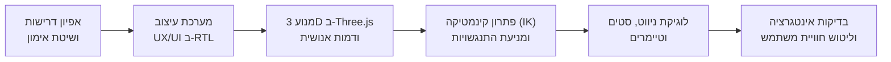
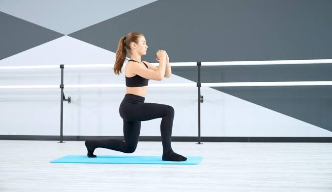
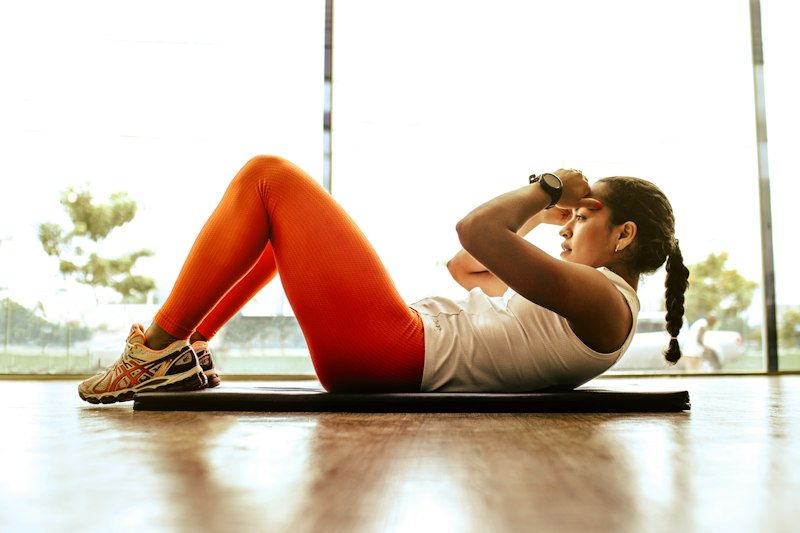
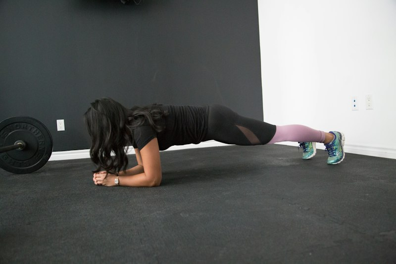

# R&L Fitness - 12-Slide Interactive Workout Platform 🏋️‍♂️

> **פלטפורמת אימון כוח אינטראקטיבית מודרנית בת 12 שקופיות, מותאמת באופן מלא לעברית (Full RTL/BiDi), הכוללת הדמיות תלת-ממדיות (Three.js 3D Simulations) עם דמות אנושית אתלטית ואנימציות תנועה מדויקות, מצבי אימון מתוזמן וחופשי, מעקב סטים וטיימר מובנה.**

---

## 📑 תוכן העניינים (Table of Contents)
1. [Project Overview & Purpose (סקירה ומטרת הפרויקט)](#1-project-overview--purpose-סקירה-ומטרת-הפרויקט)
2. [Development Methodology & Workflow (מתודולוגיית פיתוח ותהליך עבודה)](#2-development-methodology--workflow-מתודולוגיית-פיתוח-ותהליך-עבודה)
3. [Project Breakdown (פירוט שקופיות, מבנה תרגילים ומשאבים)](#3-project-breakdown-פירוט-שקופיות-מבנה-תרגילים-ומשאבים)
4. [Visual Showcase (גלריית המחשה ויזואלית)](#4-visual-showcase-גלריית-המחשה-ויזואלית)
5. [How to Run (הוראות הרצה מקומית)](#5-how-to-run-הוראות-הרצה-מקומית)
6. [Technical Stack & Architecture (ארכיטקטורה טכנולוגית)](#6-technical-stack--architecture-ארכיטקטורה-טכנולוגית)
7. [REST API Endpoints (ממשק נקודות קצה)](#7-rest-api-endpoints-ממשק-נקודות-קצה)

---

## 1. Project Overview & Purpose (סקירה ומטרת הפרויקט)

**R&L Fitness** היא פלטפורמת אימון אינטראקטיבית מקיפה בת 12 שקופיות, שנועדה להעניק חוויית אימון כוח פונקציונלי מקצועית, ברורה ומעוררת מוטיבציה באורך של **שעה אחת סה"כ**.

### מטרות הליבה של הפרויקט:
- **אימון כוח פונקציונלי שלם**: שילוב של 8 תרגילי יסוד המפעילים את כל שרשראות השרירים בגוף (רגליים, חזה, גב, זרועות, ליבה ובטן).
- **תמיכה מלאה וכפולה בעברית (Full RTL & BiDi Support)**: ממשק משתמש המתוכנן מיסודו לכיווניות ימין-שמאל (`dir="rtl"`), טיפוגרפיה עברית מאוזנת (גופני *Rubik* ו-*Heebo*), היפוך אייקונים וחצי ניווט בהתאם לכללי BIDI.
- **גמישות מתודית - שני מצבי אימון**:
  1. **מצב מתוזמן (Timed Mode)**: אימון מובנה הכולל 3 סטים לכל תרגיל, טיימר 45 שניות עם חיווי מעגלי, המלצות מנוחה של 1.5 דקות בין סטים, ונעילת כפתור "הבא" עד להשלמה מלאה של כל הסטים.
  2. **מצב חופשי (Untimed Mode)**: אימון גמיש המאפשר דילוג ומעבר חופשי בין התרגילים בקצב אישי, ללא כפיית זמנים.
- **הדמיות 3D חיות ומדויקות ב-Three.js**: מודל תלת-ממדי של דמות אנושית אתלטית המציגה את התרגילים במרחב 360 מעלות עם בקרת מצלמה, דגשי יציבה אנטומיים, ואנימציות מחזוריות חלקות של 3 שניות בתרגילים הדינמיים.
- **חוויית משתמש ועיצוב יוקרתי**: שפה חזותית בהשראת עולמות הוולנס והספורט המקצועי בגווני Sage Green, Warm Cream ו-Muted Gold, מלווה במערכת צלילים דיגיטלית עצמאית מבוססת Web Audio API ואנימציית קונפטי חגיגית בסיום.

---

## 2. Development Methodology & Workflow (מתודולוגיית פיתוח ותהליך עבודה)

הפרויקט פותח בצורה שיטתית ואיטרטיבית תוך שילוב עקרונות הנדסת תוכנה מודרניים וכלי **AI-Assisted Development**:



### עקרונות הפיתוח והארכיטקטורה:
1. **Interactive Step-by-Step Workflow**:
   - בנייה שלד השקופיות (Slide Deck Architecture) תוך שמירה על הפרדת אחריות מוחלטת: HTML סמנטי, CSS מודולרי, ומודולי JavaScript ייעודיים.
   - מעבר איטרטיבי ואימות כל רכיב אימון: טיימרים, מערכת שמע Web Audio, אנימציית קונפטי ב-Canvas, והתאמת גדלים רספונסיבית.

2. **AI-Assisted Kinematics & 3D Engineering**:
   - **בניית דמות אנושית אתלטית (Humanoid Character)**: מעבר ממודלים גנריים לדמות אנושית הכוללת תווי פנים טבעיים, שיער ספורטיבי, גוון עור אתלטי, ביגוד אימונים ונעלי ריצה.
   - **פתרון קינמטיקה הפוכה (Closed-Form 2-Link IK)**: פיתוח סולברים מתמטיים עצמאיים עבור רגלי הדמות בסקוואט, לאנצ'ים, פשיטת מרפקים ועליות מדרגה. האלגוריתם נועל ומעגן את כפות הרגליים במדויק על הרצפה או מושב הכיסא ברמת המילימטר.
   - **מניעת חיתוך גאומטרי (Mesh Clipping Prevention)**: כיול מרחבי מדויק בעליות מדרגה על כיסא (Step-ups), תוך הזזת האגן לצידו של הכיסא ויצירת מרווח בטוח של מעל 14 ס"מ בין הרגל המרחפת למושב ולרגלי הכיסא.
   - **אנימציות מחזוריות חלקות של 3 שניות**: החלת אינטרפולציית קוסינוס חלקה המניעה את התרגילים הדינמיים (Squats, Push-ups, Bench Dips, Step-ups, Lunges, Superman, Crunches) במחזור רציף ללא קפיצות או חוסר רציפות.

3. **שילוב טכנולוגיות צד-לקוח עצמאיות (Zero External Runtime Bloat)**:
   - קובצי Three.js ו-OrbitControls מאוחסנים מקומית בתיקיית `static/js/` ומאפשרים עבודה מלאה Offline.
   - מחולל צלילים דיגיטלי (*Web Audio API*) המסנתז צלילי ביפ, טיימר, באנר וסיום ישירות מהדפדפן ללא צורך בהורדת קובצי MP3 חיצוניים.
   - שרת Flask קל-משקל ב-Python לניהול שירות הקבצים וממשק REST API מובנה.

---

## 3. Project Breakdown (פירוט שקופיות, מבנה תרגילים ומשאבים)

### 3.1 מבנה 12 השקופיות (Presentation & Slide Architecture)

פלטפורמת האימון בנויה כמצגת אינטראקטיבית מלאה בת 12 שקופיות:

```
┌─────────────────────────────────────────────────────────────────────────────┐
│ 1. Welcome & Setup Screen       (מסך פתיחה, הגדרת אימון ובחירת מצב)          │
│ 2. Exercise 1: Squats           (סקוואטים - ירכיים וישבן)                    │
│ 3. Exercise 2: Push-ups         (שכיבות סמיכה - חזה וכתפיים)                │
│ 4. Exercise 3: Bench Dips       (פשיטת מרפקים - יד אחורית)                   │
│ 5. Exercise 4: Step-ups         (עליות מדרגה על כיסא - ארבע ראשי וישבן)     │
│ 6. Exercise 5: Lunges           (לאנצ'ים - כוח ואיזון שרירי רגליים)          │
│ 7. Exercise 6: Superman         (סופרמן - זוקפי גב ושרשרת אחורית)            │
│ 8. Exercise 7: Crunches         (כפיפות בטן - שרירי בטן ישרים)              │
│ 9. Exercise 8: Plank            (פלאנק - ליבה ומייצבים)                      │
│ 10. Workout Completion Screen   (מסך סיום חגיגי, קונפטי ומדדי אימון)        │
│ 11. Post-Workout Recovery Guide (מדריך התאוששות, תזונה ומתיחות)              │
│ 12. Exercise Summary & Print    (דוח סיכום אימון להדפסה ולייצוא)            │
└─────────────────────────────────────────────────────────────────────────────┘
```

---

### 3.2 מבנה כרטיס תרגיל (Exercise Card Anatomy)

כל אחת משקופיות התרגילים (שקופיות 2 עד 9) בנויה מפריסה מודרנית דו-טורית:

| רכיב | תיאור ותפקיד |
| :--- | :--- |
| **Header Top** | מספר התרגיל, שם התרגיל בעברית ובאנגלית, תגיות קבוצות שרירים אנטומיות (*Muscle Badges*). |
| **Instructions Card** | פירוט טכני של אופן הביצוע: עמידת מוצא, מסלול התנועה, נשימה ודגשי בטיחות. |
| **3D Simulation Button** | כפתור בולט עם אייקון קובייה המפעיל את מודאל ההדמיה התלת-ממדית. |
| **Media Card** | תמונת סטוק מקצועית מקומית המדגימה מתאמן בטכניקה אופטימלית, כולל תגית תיאורית עליונה. |
| **Sets & Timer Tracker** | לוח מעקב אחר 3 סטים, טיימר 45 שניות מונפש (עיגול SVG), כפתורי הפעלה/השהיה/איפוס. |
| **Completion Banner** | באנר סיום סט מונפש הנפתח עם צליל חגיגי ומאפשר מעבר לתרגיל הבא במצב מתוזמן. |

---

### 3.3 מנוע ההדמיות התלת-ממדי (Three.js 3D Simulation Engine)

מערכת ההדמיה כוללת דמות אנושית מתקדמת וסביבת אימונים אינטראקטיבית:

```
                ┌─────────────────────────────────────┐
                │        3D Canvas Viewport           │
                │   (360° OrbitControls Interaction)  │
                ├─────────────────────────────────────┤
                │      Humanoid Athletic Mannequin    │
                │   + Stage Props (Mat / Bench / Chair)│
                ├─────────────────────────────────────┤
                │    Dynamic 3s Cycles / Static Hold  │
                ├─────────────────────────────────────┤
                │  Camera Views: Default, Side, Front │
                │  Form Cues Checklist (Technical)    │
                └─────────────────────────────────────┘
```

- **Squats (סקוואט)**: מחזור 3 שניות – ירידה ל-90 מעלות ועלייה מלאה לעמידה; כפות הרגליים מקובעות לרצפה באמצעות IK.
- **Push-ups (שכיבות סמיכה)**: מחזור 3 שניות – כיפוף מרפקים מבוקר מגובה מלא ודחיפה חזרה; כפות ידיים שטוחות על הרצפה.
- **Bench Dips (פשיטת מרפקים)**: מחזור 3 שניות – ירידה מבוקרת לפני ספסל/ספה ודחיפה באמצעות היד האחורית.
- **Step-ups (עליות מדרגה)**: מחזור 3 שניות – רגל אחת נעולה על מושב הכיסא, רגל שנייה עולה ויורדת לצידו של הכיסא ללא חיתוך.
- **Lunges (לאנצ'ים)**: מחזור 3 שניות – מרפקים מופנים החוצה וידיים על המותניים, עלייה וירידה מונעות ישירות דרך הברכיים.
- **Superman (סופרמן)**: מחזור 3 שניות – שכיבה על הבטן, הרמה מבוקרת של הזרועות והרגליים הישרות באוויר ללא נגיעה ברצפה.
- **Crunches (כפיפות בטן)**: מחזור 3 שניות – שכיבה ישרה על הגב, עלייה לחצי הדרך לכיוון הברכיים עם ידיים תומכות בעורף וחזרה.
- **Plank (פלאנק)**: מנח סטטי נקי ומדויק – אמות ובהונות נשענות על המזרן, קו גוף ישר ויציב.

---

### 3.4 קטלוג תמונות ומשאבים מקומיים (Local Image Assets)

כל קובצי המדיה מאוחסנים מקומית בתיקיית `static/images/`:

| תרגיל | שם קובץ מקומי | נתיב שימוש בפרויקט | תיאור חזותי |
| :--- | :--- | :--- | :--- |
| **סקוואט** | `squat.jfif` | `/static/images/squat.jfif` | עמידת סקוואט עמוקה עם גב יציב וזקוף |
| **שכיבות סמיכה** | `chest.jfif` | `/static/images/chest.jfif` | שכיבת סמיכה במפתח כתפיים רחב על מזרן |
| **פשיטת מרפקים** | `triceps.jfif` | `/static/images/triceps.jfif` | פשיטת מרפקים על קצה ספסל אימונים |
| **עליות מדרגה** | `chair.jfif` | `/static/images/chair.jfif` | עליית מדרגה אתלטית עם רגל מוגבהת על כיסא |
| **לאנצ'ים** | `lange.jpg` | `/static/images/lange.jpg` | לאנץ' עמוק ומאוזן עם גב ישר וידיים על המותניים |
| **סופרמן** | `superman.jfif` | `/static/images/superman.jfif` | מנח סופרמן בשכיבה על הבטן עם ידיים ורגליים מורמות |
| **כפיפות בטן** | `crunches.jpg` | `/static/images/crunches.jpg` | שכיבה על הגב עם ברכיים כפופות וידיים תומכות בראש |
| **פלאנק** | `plank.jpg` | `/static/images/plank.jpg` | מנח גשר סטטי על האמות עם כיווץ ליבה |

---

## 4. Visual Showcase (גלריית המחשה ויזואלית)

להלן תצוגה מייצגת של תמונות התרגילים מתוך שקופיות האימון:

| סקוואט (Squats) | שכיבות סמיכה (Push-ups) | פשיטת מרפקים (Bench Dips) | עליות מדרגה (Step-ups) |
| :---: | :---: | :---: | :---: |
|  |  |  |  |

| לאנצ'ים (Lunges) | סופרמן (Superman) | כפיפות בטן (Crunches) | פלאנק (Plank) |
| :---: | :---: | :---: | :---: |
|  |  |  |  |

---

## 5. How to Run (הוראות הרצה מקומית)

ניתן להפעיל את הפרויקט במספר דרכים קלות ומהירות:

### אפשרות 1: הפעלה באמצעות שרת Python Flask (מומלץ)

שרת ה-Flask מספק את כל התכונות, כולל נקודות קצה של REST API ושמירת סיכום אימונים:

1. **דרישות מוקדמות**:
   - ודאו שמותקן במחשבכם **Python 3.9 ומעלה**.
2. **פתיחת תיקיית הפרויקט בטרמינל**:
   ```bash
   cd C:\VibeCoding\LiyaRoni-ex1
   ```
3. **התקנת חבילות נדרשות**:
   ```bash
   pip install -r requirements.txt
   ```
4. **הרצת השרת**:
   ```bash
   python app.py
   # או באמצעות py launcher ב-Windows:
   py app.py
   ```
5. **גלישה לאפליקציה**:
   פתחו את הדפדפן בכתובת:
   ```
   http://127.0.0.1:5000
   ```

> [!TIP]
> **הפעלה מהירה בלחיצה אחת ב-Windows**: ניתן פשוט ללחוץ לחיצה כפולה על הקובץ **`run.bat`** שבשורש הפרויקט. הקובץ מזהה את התקנת ה-Python ומפעיל את השרת באופן אוטומטי.

---

### אפשרות 2: הפעלה באמצעות VS Code Live Server או דפדפן ישיר

מאחר שכל קובצי התשתית (כולל Three.js, OrbitControls, תמונות וסאונד) מאוחסנים מקומית בפרויקט, ניתן להריץ את צד-הלקוח גם ישירות ללא שרת Flask:

1. פתחו את תיקיית הפרויקט ב-**VS Code**.
2. התקינו את התוסף **Live Server** (של Ritwick Dey) אם אינו מותקן.
3. נווטו לקובץ `templates/index.html`.
4. לחצו על מקש ימני ובחרו **"Open with Live Server"** (או לחצו על כפתור *Go Live* בסרגל התחתון).
5. הדפדפן ייפתח אוטומטית בכתובת כגון:
   ```
   http://127.0.0.1:5500/templates/index.html
   ```

---

## 6. Technical Stack & Architecture (ארכיטקטורה טכנולוגית)

```
LiyaRoni-ex1/
├── app.py                     # שרת Python Flask המספק שירות סטטי ו-REST API
├── run.bat                    # קובץ אצווה (Batch Script) להרצה מהירה ב-Windows
├── requirements.txt           # חבילות Python נדרשות (Flask, Werkzeug, Jinja2)
├── README.md                  # תיעוד מקיף של הפרויקט (מדריך זה)
├── static/
│   ├── css/
│   │   └── style.css          # עיצוב מלא: RTL, מערכת צבעים, טיפוגרפיה, Flexbox/Grid
│   ├── images/                # קטלוג תמונות מקומיות איכותיות עבור 8 התרגילים
│   │   ├── squat.jfif
│   │   ├── chest.jfif
│   │   ├── triceps.jfif
│   │   ├── chair.jfif
│   │   ├── lange.jpg
│   │   ├── superman.jfif
│   │   ├── crunches.jpg
│   │   └── plank.jpg
│   └── js/
│       ├── three.min.js       # ספריית Three.js המקומית
│       ├── OrbitControls.js   # בקר מצלמה אינטראקטיבי 360 מעלות
│       ├── mannequin.js       # בונה דמות אנושית ואביזרי אימון (מזרן, ספה, כיסא)
│       ├── animations.js      # מנוע תנועות וקינמטיקה IK עבור 8 התרגילים
│       ├── simulator.js       # מנהל חלון המודאל התלת-ממדי, זוויות צפייה ותאורה
│       ├── audio.js           # סינתיסייזר שמע דיגיטלי עצמאי (Web Audio API)
│       ├── confetti.js        # מנוע חלקיקי קונפטי למסך הסיום
│       └── app.js             # מנוע האפליקציה: ניווט בין שקופיות, ניהול סטים וטיימר
└── templates/
    └── index.html             # תבנית HTML5 ראשית המכילה את כל השקופיות והמודאלים
```

---

## 7. REST API Endpoints (ממשק נקודות קצה)

שרת ה-Flask מספק בנוסף גם שירותי Web API פנימיים:

- **`GET /api/exercises`**:
  מחזיר את קטלוג 8 התרגילי בפורמט JSON עשיר, כולל שמות בעברית ובאנגלית, שרירי מטרה, הנחיות ביצוע מדויקות ומטא-נתונים.
- **`POST /api/workout-summary`**:
  מקבל נתוני סיכום מפורטים בתום האימון (משך זמן בדקות, כמות סטים שהושלמה, קלוריות שנשרפו ומצב אימון) ושומר אותם במערכת.
- **`GET /api/stats`**:
  מחזיר נתונים סטטיסטיים מצרפיים על אימונים קודמים שהושלמו.

---

**אימון מהנה, פורה ובטוח!**  
*צוות R&L Fitness* 🏋️‍♀️✨